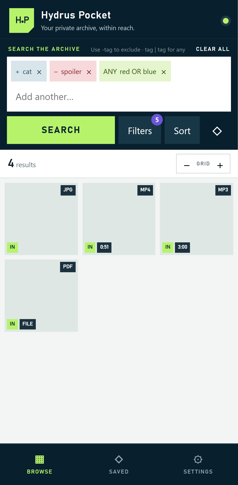

# Hydrus Pocket

Hydrus Pocket is a phone-first, tailnet-only companion for privately searching, browsing, viewing, and lightly organizing a mixed-media [Hydrus Network](https://hydrusnetwork.github.io/hydrus/) archive.

It runs beside Hydrus on a Windows computer. A localhost-only gateway owns the Hydrus credential, while phones and laptops connect to the same-origin PWA through Tailscale Serve. The permanent Hydrus access key is never sent to a browser.

> Hydrus Pocket is an independent community project. It is not affiliated with or endorsed by the Hydrus Network project or its developer. Install and run it at your own risk! I made it as light as possible. If you want a feature, add an issue or open a bruch/pr yourself.

Many thanks to the original [Hydrus](https://github.com/hydrusnetwork) developer for making the amazing software in the first place.


## Features

- Display-tag autocomplete with positive, negative, OR, and system predicates
- Media, inbox/archive, date, duration, size, dimension, service, sort, and result-limit controls
- Virtualized, aspect-ratio-preserving gallery for large result sets
- Image, JPEG XL, animation, video, audio, and unsupported-file viewing
- Native byte-range video playback with viewer-first network scheduling
- 200 MB page-session lookahead cache with protected nearby navigation history
- Double-tap, double-click, pinch, pan, swipe navigation, and keyboard controls
- Tag inspection, local tag add/remove, and archive/unarchive
- Saved and recent searches stored only on the current device
- Installable PWA, health diagnostics, explicit recovery states, and dark mode
- Localhost credential boundary, redacted logs, rate limiting, CSP, and validated API routes

Hydrus Pocket deliberately does not replace the Hydrus desktop client. File deletion, downloaders, repository moderation, service administration, ratings, notes, duplicate processing, and relationship management are outside its browsing-first scope.

## Requirements

- Windows 10 or 11 host
- Hydrus Network with Client API v83 or newer
- Node.js 22, 23, or 24 and npm
- Tailscale installed and signed in on the host and viewing devices
- PowerShell 5.1 or newer
- Android Chrome is the primary client; current Chromium desktop browsers are supported

Hydrus should remain bound to localhost. No router port forwarding or public Funnel is required.

## Install

1. Clone the repository and install dependencies:

   ```powershell
   git clone https://github.com/matvei77/hydrus-phone.git
   cd hydrus-phone
   npm ci
   ```

2. In Hydrus, open **services → review services → client api**, add a service if needed, and open its permission-registration dialog.

3. Request the minimum required permissions and create `.env`:

   ```powershell
   powershell -ExecutionPolicy Bypass -File scripts/request-hydrus-access.ps1
   ```

   Approve **Hydrus Pocket** in Hydrus. The script requests search/fetch, tag editing, and add-files—the permission Hydrus currently uses for archive/unarchive.

4. Install the production build, auto-start supervisor, and Tailscale Serve mapping:

   ```powershell
   powershell -ExecutionPolicy Bypass -File scripts/install-windows.ps1
   ```

5. Open the HTTPS URL printed by the installer from a device in the same tailnet. Chrome can install it from the browser menu.

If Tailscale is not installed, the gateway is still available locally at the configured `HOST` and `PORT`, but remote access is not configured.

See [Deployment](docs/DEPLOYMENT.md), [Operations](docs/OPERATIONS.md), and [Security](SECURITY.md) for updates, rollback, recovery, and the threat model.

## Configuration

Copy `.env.example` only when configuring manually. Never commit `.env`.

| Variable            | Required | Default                  | Purpose                                                  |
| ------------------- | -------- | ------------------------ | -------------------------------------------------------- |
| `HYDRUS_URL`        | No       | `http://127.0.0.1:45869` | Local Hydrus Client API                                  |
| `HYDRUS_ACCESS_KEY` | Yes      | —                        | 64-character Hydrus key, server-side only                |
| `HOST`              | No       | `127.0.0.1`              | Gateway bind address; keep localhost for Tailscale Serve |
| `PORT`              | No       | `47810`                  | Gateway port                                             |
| `APP_URL`           | No       | discovered               | Tailnet HTTPS URL shown in Settings                      |
| `LOG_LEVEL`         | No       | `info`                   | Fastify log level                                        |

The setup script discovers the host's Tailscale DNS name automatically. Override it with `-AppUrl` only when necessary.

## Development

```powershell
npm ci
npm run dev
```

The development UI runs through Vite and the gateway reloads through `tsx`. A valid `.env` and running Hydrus instance are required for real data.

Quality gates:

```powershell
npm run check:release
$env:HYDRUS_POCKET_URL = "https://your-host.your-tailnet.ts.net"
npm run test:e2e:live
```

`check:release` runs lint, TypeScript checks, unit/integration tests, a production build, 21 Playwright workflows across Android/desktop/dark layouts, accessibility checks, and a production dependency audit.

## Project documentation

- [Product scope](docs/PRODUCT.md)
- [Architecture](docs/ARCHITECTURE.md)
- [Hydrus API contract](docs/HYDRUS_API.md)
- [Production-readiness audit](docs/AUDIT.md)
- [Testing](docs/TESTING.md)
- [Accessibility](docs/ACCESSIBILITY.md)
- [Performance](docs/PERFORMANCE.md)
- [Public release procedure](docs/PUBLIC_RELEASE.md)
- [Contributing](CONTRIBUTING.md)
- [Support](SUPPORT.md)
- [Changelog](CHANGELOG.md)

## License 

Copyright 2026 Hydrus Pocket contributors.

Licensed under the [Apache License 2.0](LICENSE). Dependencies retain their respective licenses; see [THIRD_PARTY_NOTICES.md](THIRD_PARTY_NOTICES.md).
